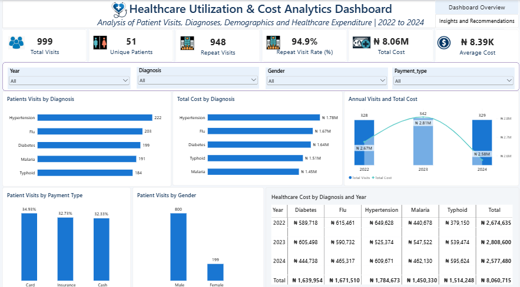
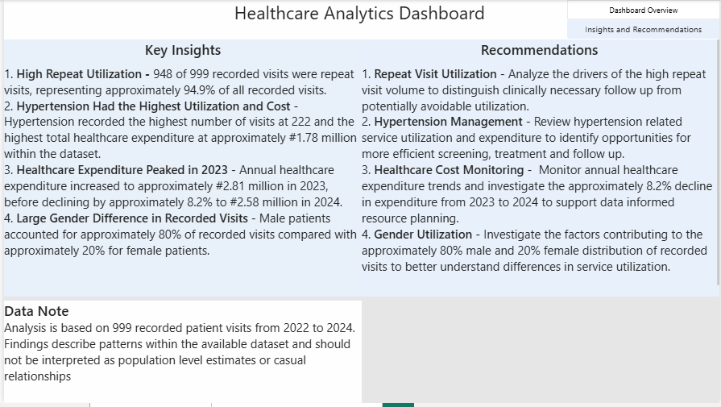

# Healthcare Utilization & Cost Analytics Dashboard

## Project Overview

This project analyzes a synthetic healthcare patient visits dataset to examine patterns in healthcare utilization, diagnoses, demographics, payment methods and healthcare expenditure.

The project demonstrates an end to end data analytics workflow, from data cleaning and validation in Excel to SQL analysis and interactive visualization in Power BI.

## Project Objectives

The objectives of this project were to:

* Analyze patient visit patterns and healthcare utilization
* Identify the most frequently recorded diagnoses
* Examine healthcare expenditure across diagnoses and years
* Analyze patient demographics and payment methods
* Identify repeat visit patterns
* Develop actionable insights from the available data
* Present findings through an interactive Power BI dashboard

## Dataset

The dataset contains 999 recorded healthcare visits covering the period from 2022 to 2024.

The dataset is **synthetic and created for analytical and portfolio purposes**. It does not represent real patient records or population level healthcare estimates.

### Key Dataset Metrics

| Metric | Value |
|---|---:|
| Total Recorded Visits | 999 |
| Unique Patients | 51 |
| Repeat Visits | 948 |
| Repeat Visit Rate | 94.9% |
| Total Healthcare Cost | ₦8.06M |
| Average Cost per Visit | ₦8.39K |
| Analysis Period | 2022 to 2024 |
| Missing Cost Records | 38 |

## Data Cleaning and Preparation

The original dataset contained inconsistencies that required cleaning before analysis.

The data preparation process included:

* Reviewing the dataset for inconsistencies
* Standardizing date formats
* Removing duplicate records
* Cleaning healthcare cost values
* Identifying missing cost values
* Validating patient and visit identifiers
* Checking categorical fields such as gender, diagnosis and payment type
* Preparing the cleaned dataset for SQL Server and Power BI

One duplicate record was identified and removed, resulting in 999 final records.

## SQL Analysis

SQL Server was used to validate the cleaned dataset and perform exploratory analysis.

The analysis included:

* Total number of recorded visits
* Number of unique patients
* Repeat visit analysis
* Patient visit frequency
* Diagnosis distribution
* Healthcare cost by diagnosis
* Annual healthcare expenditure
* Payment type distribution
* Gender distribution
* Missing value assessment

The SQL analysis helped validate the dataset and generate the metrics used in the Power BI dashboard.

## Power BI Dashboard

The interactive Power BI dashboard presents healthcare utilization and expenditure patterns across several dimensions.

### Dashboard Components

* Total Visits
* Unique Patients
* Repeat Visits
* Repeat Visit Rate
* Total Healthcare Cost
* Average Cost per Visit
* Patient Visits by Diagnosis
* Total Cost by Diagnosis
* Annual Visits and Healthcare Cost
* Patient Visits by Payment Type
* Patient Visits by Gender
* Healthcare Cost by Diagnosis and Year

### Interactive Filters

Users can explore the dashboard using filters for:

* Year
* Diagnosis
* Gender
* Payment Type

Dashboard Preview

Healthcare Utilization & Cost Analytics Dashboard

The Power BI dashboard explores patient visits, diagnoses, demographics, and healthcare expenditure from 2022 to 2024.

Insights and Recommendations

The analysis highlights patterns in repeat visit volume, diagnosis related expenditure, annual healthcare costs, and recorded visits by gender.

To explore the report interactively, see the Power BI file in the powerbi/ folder.

## Key Findings

### 1. High Repeat Visit Volume

The dataset contains 999 recorded visits across 51 unique patients. Of these, 948 visits occurred beyond each patient's first recorded visit, representing approximately 94.9% of all recorded visits.

### 2. Hypertension Had the Highest Utilisation and Cost

Hypertension recorded the highest number of visits at 222 and the highest total healthcare expenditure at approximately ₦1.78 million.

### 3. Healthcare Expenditure Peaked in 2023

Annual healthcare expenditure increased to approximately ₦2.81 million in 2023, before declining by approximately 8.2% to ₦2.58 million in 2024.

### 4. Large Gender Difference in Recorded Visits

Male patients accounted for approximately 80% of recorded visits, compared with approximately 20% for female patients.

## Recommendations

### 1. Hypertension Management

Review hypertension related service utilisation and expenditure to identify opportunities for more efficient screening, treatment and follow up.

### 2. Repeat Visit Utilisation

Analyse the drivers of the high repeat visit volume to distinguish clinically necessary follow up from potentially avoidable utilisation.

### 3. Healthcare Cost Monitoring

Monitor annual healthcare expenditure trends and investigate the approximately 8.2% decline in expenditure from 2023 to 2024.

### 4. Gender Utilisation

Investigate the factors contributing to the approximately 80% male and 20% female distribution of recorded visits to better understand differences in service utilisation.

## Tools and Technologies

* Microsoft Excel
* SQL Server
* Power BI
* SQL
* Data Cleaning
* Exploratory Data Analysis
* Data Visualization
* Healthcare Analytics

## Data Limitations

This analysis uses a synthetic dataset of 999 recorded patient visits and does not represent actual healthcare utilisation or population-level estimates. The dataset contains 961 available cost values and 38 missing cost values. Missing values were retained and not imputed; total healthcare expenditure and average cost were calculated using available cost values only.

The analysis identifies patterns in repeat visit volume, gender distribution, and healthcare expenditure but does not establish causal relationships or demonstrate broader healthcare trends.

## Project Outcome

This project demonstrates the ability to transform a raw healthcare dataset into a structured analytical solution using Excel, SQL Server and Power BI.

The workflow covers:

**Data Cleaning → Data Validation → SQL Analysis → Data Visualization → Insights → Recommendations**

The project forms part of my developing portfolio in **healthcare analytics, public health data analysis and monitoring and evaluation**.
